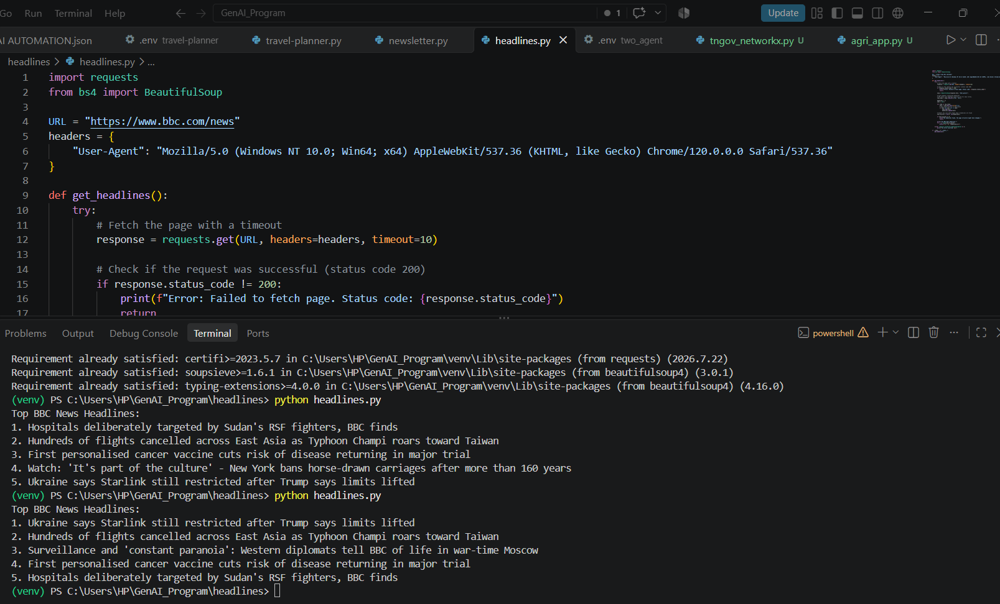

# BBC Top Headlines Scraper

> Print today's top 5 BBC News headlines in your terminal.

 

## Overview

A small, well-behaved web scraper. It requests the BBC News homepage with a browser-like User-Agent and a timeout, parses `h2`/`h3` headings with BeautifulSoup, removes duplicates and prints the top 5. It reports clearly when the request fails or the page layout changes.

## Demo




## Tech stack

| Layer | Technology |
|---|---|
| HTTP | requests |
| Parsing | BeautifulSoup |

## Project structure

```text
.
├── headlines.py
└── requirements.txt
```

## Getting started

**Prerequisites:** Python 3.10+

```bash
git clone https://github.com/prasanth-sundararajan/headlines.git
cd headlines
python -m venv .venv
# Windows: .venv\Scripts\activate    macOS/Linux: source .venv/bin/activate
pip install -r requirements.txt
```

## Usage

```bash
python headlines.py
```

## License

Released under the [MIT License](LICENSE).

## Author

**Prasanth Sundararajan**, Senior SRE and AI Engineer  
[LinkedIn](https://www.linkedin.com/in/prasanth-s-a093a7109/) · [GitHub](https://github.com/prasanth-sundararajan)
